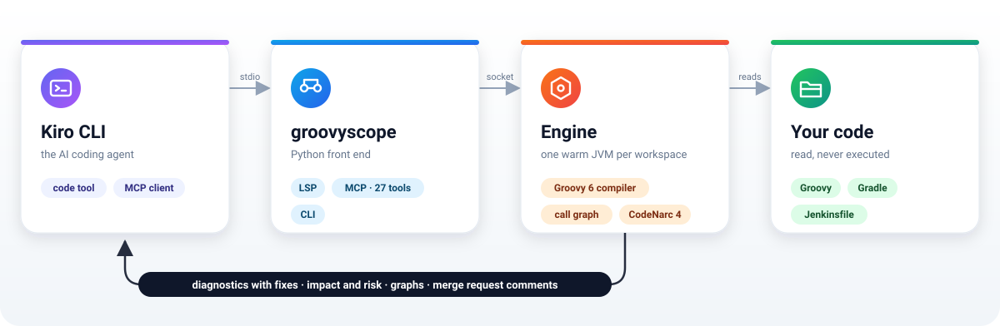

# groovyscope

[](https://github.com/SCGIS-Wales/groovyscope/actions/workflows/ci.yml)
[](https://pypi.org/project/groovyscope/)
[](LICENSE)

Groovy 5/6 code intelligence for AI coding agents, with [Kiro CLI](https://kiro.dev) as the first consumer.

One warm JVM engine (Apache Groovy 6 compiler, CodeNarc 4, Groovy's static type checker and a conservative
formatter) answers semantic questions about Groovy, Gradle and Jenkinsfile code. Two front ends share it:

- an **LSP server** that Kiro CLI spawns from `.kiro/settings/lsp.json` and uses through its built-in `code`
  tool (definition, references, rename, diagnostics, hover, symbols);
- an **MCP server** for the questions LSP cannot express: a map of the workspace, the source of one
  declaration, structural code search, duplicated code, impact of a change, call graphs, lint, format and
  security findings, returned as compact JSON so the agent stops reaching for `grep`, `sed`, `head` and `tail`.

Python owns the installer, CLI, configuration and MCP bridge. Every semantic answer comes from the JVM.

## Quick start

You need a JDK 17 or newer (21 recommended; Temurin, Amazon Corretto or any other build) and Kiro CLI. Once per
machine:

```bash
uv tool install groovyscope       # or: pipx install groovyscope, or: brew install SCGIS-Wales/tap/groovyscope
                                  # Python 3.12 to 3.15; the engine needs a JDK 17 or newer (see docs/install.md)
groovyscope kiro init --global    # adds groovyscope to ~/.kiro without removing anything already there
groovyscope doctor                # ok lines are good; info lines are optional extras
```

Then open any Groovy project:

```bash
cd your-groovy-project
kiro-cli --agent groovy
> /code status                    # expect: groovyscope (groovy) - initialized
> /mcp                            # expect: groovyscope running 29 tools
```

Nothing else to run. When the `groovy` agent starts, its start hook runs `groovyscope checkup --agent`: it
refreshes the Kiro files after an upgrade, writes the project's LSP entry, unpacks the benchmark corpus, and
tells the agent what still needs your decision (trusting the repository and exporting its classpath, which run
the build). The agent opens with that status and a menu of the most useful prompts; say yes and it runs
`groovyscope trust` and `groovyscope classpath` for you. `groovyscope checkup` prints the same report in a
terminal. Without a classpath the engine still answers from the project's own sources; imports of library
classes then surface as one `GS100` "missing dependencies" warning per file instead of a wall of
unresolved-class errors. [docs/prompts.md](docs/prompts.md) lists the prompts and how to read the answers.

`kiro init --global` merges into `~/.kiro/settings/mcp.json`, `~/.kiro/agents/groovy.json` and
`~/.kiro/steering/`: other MCP servers and agent settings stay as they are, every changed file is backed up to
`<file>.bak`, and the diff is printed. Add `--dry-run` to see the diff without writing. In a project,
`groovyscope kiro init --full` writes all the files there instead, for a setup the whole team can commit.
Details in [docs/kiro.md](docs/kiro.md).

No JDK? The Homebrew formula brings one. Otherwise `groovyscope jdk install` downloads a checksum-verified
Temurin JDK into groovyscope's cache; nothing is downloaded unless you ask. See [docs/install.md](docs/install.md).

## What it does

One warm JVM per workspace compiles the code with the Groovy 6 compiler and serves go to definition, find
references, hover, symbols, completion, signature help, rename with a dry run, call hierarchy, semantic tokens
and diagnostics. Every answer carries a confidence (`STATIC`, `INFERRED`, `DYNAMIC_UNKNOWN`); rename refuses
rather than guesses when a call site can only be matched by name. Findings come from four sources:

- the compiler and Groovy 6's type checkers (NullChecker, SqlInjection, Regex, FormatString, Combiner, Purity);
- CodeNarc 4 with a profile aligned with the [practices knowledge base](docs/practices.md); the engine build
  embeds the latest stable CodeNarc release on Maven Central at build time (`groovyscope version` prints it);
- groovyscope's own practice checks, GS001 to GS012 (integer division, Elvis on 0, GString logging, `Eval`,
  `@Grab`, string `execute()`, XXE, Groovy 6-only syntax under a Groovy 5 target and more), GS020 to GS027
  (names that say what things are and do: booleans as questions, verbs on methods, no generic words,
  abbreviations or type prefixes, names that match their types, one verb per idea), and GS100, one warning
  per file whose imports cannot resolve because no classpath is configured;
- optional [runtime profiles](docs/profiles.md) (RP codes) for plugin code that runs on a different Groovy and
  classpath than the local build: constructs not proven on the runtime, descriptor parameter mistakes, secret
  flows, contract drift against a recorded baseline, and an emulation compile with the runtime's own Groovy.

`groovyscope fix` and the `fix` MCP tool apply the safe fixes (adding `@CompileStatic` only when the class
then type-checks, `intdiv`, typed parameter reads and more) and reject any edit that would stop the file
parsing. `explain` says why a finding matters and how to fix it.

For reading code, the MCP server gives the agent a map of the workspace (`workspace_overview`), the outline of
a file with line ranges (`document_symbols`), the source of one declaration with line numbers (`read_symbol`),
a structural search over the compiled trees (`find_code`: catch blocks that swallow `Exception`, calls by name
or receiver type, `return null`, string literals matching a pattern, annotations, `def` declarations, empty
blocks, long methods) and duplicated code with identifiers and literals ignored (`find_duplicates`). None of
them returns a whole file.

## Architecture

<picture>
  <source media="(prefers-color-scheme: dark)" srcset="docs/images/architecture-dark.svg">
  
</picture>

Kiro CLI talks to groovyscope over stdio (LSP for its `code` tool, MCP for everything else). groovyscope keeps one
warm JVM per workspace and talks to it over a Unix socket. The JVM compiles and indexes your code, never runs it,
and sends back answers the agent can act on. Package by package: [docs/architecture.md](docs/architecture.md).

## Commands

| Command | What it does |
|---|---|
| `groovyscope hook` | What the groovy agent's `postToolUse` and `stop` hooks run (the hook JSON arrives on stdin): after a write, the Groovy file just written is checked and the findings go back to the agent in the same turn; with `hooks.stopGate: true`, the turn is refused while changed Groovy files have compile errors. Never fails the session |
| `groovyscope checkup [--fix] [--agent] [--json]` | Everything to do after an install or upgrade, one line per item with the exact fix: Kiro files older than the package, project LSP entry, trust, classpath, hidden MCP servers, agent format, JDK, engine JAR, daemon. `--fix` applies the safe repairs; `--agent` is what the groovy agent's start hook runs |
| `groovyscope doctor [--bundle report.zip]` | Checks Python, configuration and trust, JDK (vendor and version), the engine JAR (SHA-256), Kiro files, the Kiro agent's format and runtime profiles; `--bundle` writes a zip for bug reports |
| `groovyscope checks prepare [DIR] [--force] \| report` | The owner's Kiro checks ([docs/kiro-checks.md](docs/kiro-checks.md)): `prepare` builds a throwaway workspace (CodeNarc sources, `build.gradle`, `Jenkinsfile`, git history with a `change` branch to review, Kiro LSP entry, trust) without changing your shell's directory; `report` prints versions, the doctor lines, the hook start-up time and the result table to paste back |
| `groovyscope logs [-n N] [-f] [--kiro]` | The engine daemon's log for this workspace, or groovyscope's lines from Kiro CLI's logs |
| `groovyscope trust [--revoke] [--list]` | Trust this workspace, so its `.groovyscope.yaml` may set `workspace.trust`, `jdk.home` and rule sets, and `classpath` may run its build tool ([security](docs/security.md)) |
| `groovyscope init [--dry-run]` | Writes a starting `.groovyscope.yaml` (source roots, Groovy version) from the project's layout and build files; existing settings win |
| `groovyscope classpath [--tool gradle\|maven] [--timeout N]` | Asks the project's Gradle (init script) or Maven build for its compile and test classpath and writes it to `workspace.classpathFile` with a fingerprint of the build files, so a later dependency change shows as `stale`; a running daemon reloads it in place. Trusted workspaces only, since it runs the build scripts |
| `groovyscope kiro init \| repair [--global] [--full] [--agent-format auto\|v2\|universal\|v3] [--dry-run]` | Installs or re-merges the Kiro files: MCP server, agent and steering in `~/.kiro` with `--global`; the LSP entry (everything with `--full`) in a project. The agent keeps its format (V2, universal or V3) and its `tools: ["*"]`, so every MCP server you have stays usable. Also writes the twelve skills (`/groovy-review`, `/groovy-impact`, ...), one per cookbook recipe, loaded only when invoked; the MCP server serves them as prompts too |
| `groovyscope check [PATHS] [--include lint,compile,typecheck,practices] [--format text\|json\|short\|sarif] [--import-sarif FILE]` | All findings, plus the build's SARIF findings (SpotBugs; `reports.sarif` or the default output when present); `short` matches `groovyc --error-format short`, `sarif` feeds code scanning; exits 1 at or above `lint.failOnPriority` |
| `groovyscope review [PATHS] \| --changed [--base BRANCH] [--staged]` | Findings grouped by the practices checklist; with `--changed`, the branch reviewed as a merge request against the default branch: triage (risks, smells, noise, the fix command), blocking, should fix, nits on the changed lines, impact of changed declarations, the tests the change reaches with their Gradle command, risky constructs added, uncovered methods, verdict ([docs/ci.md](docs/ci.md)) |
| `groovyscope verify [--base BRANCH] [--staged] [--dry-run] [--json]` | One step after a change: the review of the changed lines, then one Gradle command that compiles the changed source sets and runs the tests the change reaches (Groovy and Java, any source set); tests of tasks outside `verify.runTasks` (integration tests) are listed for CI; exits 1 on a failed build or test or a blocking finding |
| `groovyscope coverage [PATHS]` | Classes and methods no test executed, from the build's JaCoCo XML report (`reports.jacoco`), most missed lines first |
| `groovyscope fix [PATHS] [--code X] [--apply]` | Safe fixes; reports them unless `--apply` |
| `groovyscope explain CODE` | Why a code (GS001, RP010, NullChecker, a CodeNarc rule) matters and how to fix it |
| `groovyscope format [PATHS] [--apply]` | Bundled formatter (whitespace hygiene, safe CodeNarc-driven fixes) |
| `groovyscope impact TARGET [--change signature\|rename\|delete\|behaviour]` | Direct and transitive callers, overrides, tests, name-only sites, risk and suggested checks |
| `groovyscope callgraph TARGET [--direction in\|out] [--depth N]` | Callers of, or calls made by, a declaration with per-edge confidence |
| `groovyscope profile list \| install FILE \| validate FILE \| status PATH` | Runtime profiles found for the workspace, a validated copy into `~/.groovyscope/profiles/` (how a private profile reaches another machine), schema validation, and what governs a file |
| `groovyscope baseline save \| check` | Records the contract surface of profile-governed files; `check` exits 1 when something recorded changed |
| `groovyscope config validate [--show]` | Validates `.groovyscope.yaml` + `GROOVYSCOPE_*` overrides against the schema |
| `groovyscope lsp --stdio` / `groovyscope mcp` | What Kiro runs: LSP and MCP over the warm per-workspace daemon |
| `groovyscope daemon start \| stop \| restart \| status` | Manages the daemon (idle exit after `daemon.idleTimeoutMinutes`; `restart` applies a changed configuration) |
| `groovyscope jdk install [--vendor temurin\|corretto]` | Opt-in, checksum-verified JDK download into groovyscope's cache |
| `groovyscope explain-code TARGET` | What a class, member or file does, as facts (members, calls, callers, field writes, exceptions, external calls, branches) |
| `groovyscope graph [SYMBOLS] [--path FILE] [--kinds ...] [--depth N] [--level class\|method] [--format drawio\|mermaid\|json] [--out FILE]` | The class relationship graph as a draw.io file on A4, A3 or A2, the smallest that keeps the text readable (default `groovyscope-graph.drawio`), a Mermaid class diagram, or JSON |
| `groovyscope naming [PATHS] [--json]` | Naming findings GS020 to GS027; `--json` adds the facts behind each name |
| `groovyscope benchmark path [--to DIR] [--refresh]` | Where the bundled benchmark corpus (CodeNarc 4.0.0 `src/main`) is unpacked; `--to` puts it elsewhere. It unpacks itself on `kiro init --global` and at agent start |
| `groovyscope fetch` / `groovyscope version` | Engine JAR fetch for packages without one; versions |

Most commands take `--json`. Every command takes `--debug`, `-v`/`--verbose` and `--log-file PATH`
([debug logging](docs/troubleshooting.md#debug-logging)).

## What the `code` tool gets (LSP)

Kiro's built-in `code` tool talks LSP to `groovyscope lsp --stdio`. The server declares these capabilities:

| Capability | What it does |
|---|---|
| definition, typeDefinition, implementation | Jump to a declaration, to the type of an expression, or to the workspace subclasses and implementations of a type and the overrides of a method |
| references, documentHighlight | Every use with a confidence; the uses of the symbol under the cursor in the same file |
| hover, signatureHelp, completion | Signature and documentation, parameter hints on `(` and `,`, members after `.` |
| documentSymbol, workspaceSymbol, foldingRange | The outline of a file with ranges (served from the symbol cache before the first compile), name search across the workspace, folding regions |
| inlayHint | The inferred type shown after a dynamically typed local (`def x = ...`) whose initialiser has a known type |
| prepareRename, rename | A dry run that refuses when a use is matched by name only, then the edit |
| diagnostics (push and pull) | Compile errors, type-checker findings, CodeNarc findings down to `lint.publishMaxPriority`, GS practice checks and RP profile checks, each with a `fixable` flag and a link to its explanation |
| codeAction | Quick fixes, `source.fixAll.groovyscope` (every safe fix in the file) and `source.organizeImports` |
| formatting, rangeFormatting | The bundled formatter on a whole file or a selection |
| callHierarchy, semanticTokens | Incoming and outgoing calls from the call graph; token types and modifiers from the index |

## MCP tools

`groovyscope mcp` registers one server, `groovyscope`, with these tools. Every answer is one compact JSON text
block (no pretty printing, no second structured copy unless `output.structured: true`): paths relative to the
workspace root, 1-based `line`/`col`, a confidence where one applies, at most `output.maxResults` items within
`output.maxBytes`, finding messages clipped to `output.maxMessageChars`, and a `next_cursor` to page on. No tool
returns file bodies. Each tool carries a title and MCP behaviour annotations (read-only or not, idempotent,
closed-world), and parallel calls are queued safely on the one engine session.

| Tool | Answers |
|---|---|
| `workspace_overview()` | A map of the codebase: files and lines per package, the largest files and classes, test files and classes without a test. The first call in an unfamiliar workspace |
| `find_symbol(query, kind?, limit?, cursor?)` | Declarations whose name contains the query |
| `goto_definition(path, line, col)` | The declaration under a position, with its confidence |
| `symbol_context(path, line, col)` | Definition, hover text and reference count (by confidence) of the symbol at a position, in one call |
| `type_definition(path, line, col)` | The declaration of the type of the expression under a position |
| `hover(path, line, col)` | What an editor shows on hover: signature, documentation, runtime-profile parameter details, why a finding on that line matters |
| `document_symbols(path, depth?, kinds?, name?, limit?, cursor?)` | The outline of a file: classes and members with their first and last line and the file's line count, filtered by kind or name and paged, instead of reading it |
| `read_symbol(path, symbol, line?, max_chars?)` | The source of one class, method or field with line numbers (`name`, `Class.name` or a class name; `line` picks an overload), with the comments and annotations above it. Replaces reading line ranges |
| `find_code(kind, paths?, name?, type?, pattern?, modifiers?, empty_body?, rethrows?, min_lines?, min_parameters?, limit?, cursor?)` | Structural search over the compiled trees, instead of grep. Kinds: `catch`, `throw`, `call`, `new`, `return-null`, `string-literal`, `annotation`, `def`, `empty-block`, `field`, `method`; each match names its enclosing declaration. A catch match says how it handles the exception (`handling`: swallowed, rethrows, logged, returns-default, other), the variable name, the type caught, the CodeNarc code for `explain`, and `implicitType` when the header names no type |
| `find_duplicates(paths?, min_lines?, limit?, cursor?)` | Repeated code: groups of blocks with the same structure (identifiers, literals and message text ignored, so a block pasted with reworded log lines still counts), largest first, `EXACT` or `SIMILAR`, with every location |
| `find_references(path, line, col, include_declaration?, limit?, cursor?)` | Every reference with a confidence, plus counts per confidence |
| `call_graph(symbol, direction?, depth?)` | Callers of (`in`) or calls made by (`out`) a declaration |
| `impact_of(symbol, change?)` | Direct and transitive callers, overrides, tests, dynamic sites, risk and suggested checks |
| `check(paths?, profile?, include?, codes?, max_priority?, limit?, cursor?)` | Compile, lint, type-check and practice findings, worst first, with counts per code (`byCode`) and a `fixable` flag; `codes` keeps only those codes, `max_priority` 1 errors, 2 and warnings, 3 and info. Files whose imports cannot resolve are summarised once under `missingDependencies`. The build's SARIF findings (SpotBugs) are merged in and counted under `imported` |
| `review(paths?, top?, max_priority?)` | The same findings grouped by the review checklist, with counts per code and the profiles governing the paths |
| `review_changes(base?, staged?, top?)` | The branch reviewed as a merge request: changed files and lines from git, against the repository's default branch unless `base` is given (`origin/HEAD`, else `main` or `master`), findings on the changed lines grouped `blocking`, `shouldFix` and `nits` and ranked in `triage` (risks, smells, noise, with how many the safe fixes repair and the `groovyscope fix` command), pre-existing findings as counts, `impact` of changed declarations, `risky` constructs added, `uncovered` methods in the change, and a one-sentence `verdict`; plus `comments` (path, line, body, written for the author) and a `summaryComment` ready to post on a GitLab merge request |
| `coverage_gaps(paths?, limit?, cursor?)` | Classes and methods no test executed, from the JaCoCo XML report, most missed lines first, with the overall line coverage |
| `explain_code(symbol?, path?)` | What a class, method, field or file does, as facts: members with types, each method's parameters, return, branches, calls made (with confidence) and received, fields read and written, exceptions thrown and caught, the external world touched (http, file, sql, process, environment, clock, random, logging), public methods grouped by verb, and the classes it is used by and uses. The agent writes the prose from these, never from names |
| `relationship_graph(symbols?, paths?, kinds?, depth?, level?, max_nodes?, drawio_path?, mermaid?)` | How classes relate: `extends`, `implements`, `has` (a field typed with another class), `uses` (a public method takes or returns one), `calls` (aggregated, weakest confidence). Seeded by symbols or files with a hop depth, capped best-connected first, or one class's methods with `level: method`. `drawio_path` writes a draw.io file laid out by the engine's layered layout (lines on their own tracks, crossings minimised, shared helpers named in their users' boxes) on A4, A3 or A2, the smallest that keeps the text readable; calls point from caller to callee, blue when they only read, orange when they change state (a field, a file, a database, a remote service, a process), grey when matched by name only; the answer counts crossings, overlaps, reads and writes; `mermaid` adds a class diagram |
| `check_naming(paths?, limit?, cursor?)` | GS020 to GS027 naming findings plus the facts behind every class, field and method (type, what it writes and touches, how often it is called) so the agent can judge whether each name says what the thing is and does; renames go through `rename` |
| `fix(paths?, codes?, apply?)` | Safe fixes; a dry run unless `apply` |
| `rename(path, line, col, new_name, apply?)` | Rename everywhere it is used, refused when a use is matched by name only; a dry run unless `apply`. An applied rename is verified by recompiling the changed files and rolled back when it leaves new compile errors |
| `explain(code)` | What a code means (GS001 to GS012, GS100, RP codes, a Groovy 6 checker, a CodeNarc rule), why it matters and the fix |
| `profile_status(path)` | Target Groovy, compiling service, construct status on the runtime, descriptor parameters, test seams and protected code of a governed file |
| `format(paths?, apply?)` | Files the formatter would change; `apply` writes them |
| `find_dynamic_code(paths?, limit?, cursor?)` | Untyped classes, `def` on public API, `methodMissing`, `metaClass` writes, `@Grab`, `Eval`, `execute()` |
| `workspace_status()` | Daemon state, engine version, root, file count, trust flag, and the `classpath` state (`fresh`, `stale`, `missing`, `configured`, `none`) |
| `refresh_classpath(timeout?)` | Exports the classpath again from the build after a dependency changed (`check` says `classpath.state: stale`); the engine picks it up on its next request. Runs the build, trusted workspaces only |

## Configuration

Nothing is required. `groovyscope init` writes a starting `.groovyscope.yaml` from the project's layout and
build files. To change any other default, copy [config/defaults.yaml](config/defaults.yaml) to
`.groovyscope.yaml` in your workspace and keep only what you change. Any key can be overridden with an
environment variable, for example `GROOVYSCOPE_DAEMON__HEAP=2g`. Worth knowing: `workspace.classpathFile`
(written by `groovyscope classpath`, its entries join `workspace.classpath`), `lint.rules` (per-rule
overrides such as `{CompileStatic: off, LineLength: {priority: 3}}`), `lint.publishMaxPriority` (only
priority 1 and 2 lint findings reach the editor and the agent as diagnostics; 3 stays available through
`check` and `review`), `diagnostics.push` (`open`: after an edit only the documents the session has open get
pushed diagnostics, the default; `workspace` for every file; `none` to pull only) and
`diagnostics.debounceMillis`, `practices.severity` (per GS or RP code, `GS100: off` included), `naming`
(`allowedAbbreviations`, `vocabulary`),
`duplicates.minLines` / `duplicates.minStatements` for `find_duplicates`, and `reports.sarif` /
`reports.jacoco` for the build's SpotBugs and JaCoCo reports. Runtime profiles live in
`~/.groovyscope/profiles/` or `<workspace>/.groovyscope/profiles/` and stay out of the repository if you want
them private; see [docs/profiles.md](docs/profiles.md).

## Security posture

`@Grab` and `@ASTTest` are disabled in the engine JVM and cannot be enabled through configuration. Global AST
transforms from the workspace classpath load only with `workspace.trust: true`. The classpath comes from
configuration or from `groovyscope classpath`, which runs the project's build tool and is therefore refused
until you `groovyscope trust` the workspace; it is never inferred silently. See
[docs/security.md](docs/security.md).

## Repository layout

```
engine/   JVM engine (Java 21 sources, Gradle, Spock tests)       -> groovyscope-engine-<ver>-all.jar
python/   groovyscope package (CLI, config, Kiro writers, tests)   -> PyPI wheel bundling the JAR
config/   CodeNarc rulesets, practice catalogue, example runtime profile, formatter and groovyc configuration
          (mirrored inside the package)
kiro/     Templates written by `groovyscope kiro init` (mirrored inside the package)
docs/     Install, Kiro, prompts, CI, practices, profiles, rules, architecture, security, troubleshooting,
          benchmark, roadmap
```

## Contributing

Conventional Commit PR titles, squash merges, and releases through release-please. See
[AGENTS.md](AGENTS.md) for the build and style rules, and [docs/architecture.md](docs/architecture.md) for the
design.

Licensed under the Apache License 2.0.
